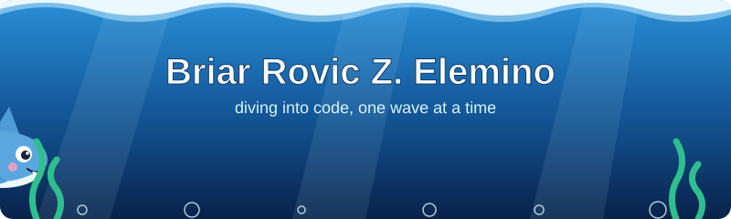

 

---

### 🌊 `about me`

Hi, I’m **Harizthyl**, also known as **Sharky** 🦈. I build random stuff, from school projects to personal games.

🐚 Learning **ReactJS** · 🫧 Professional **AI Prompt Engineer**

### 🐠 `tools in my tank`

### 📈 `ocean report`

### 🐚 `send a message in a bottle`

